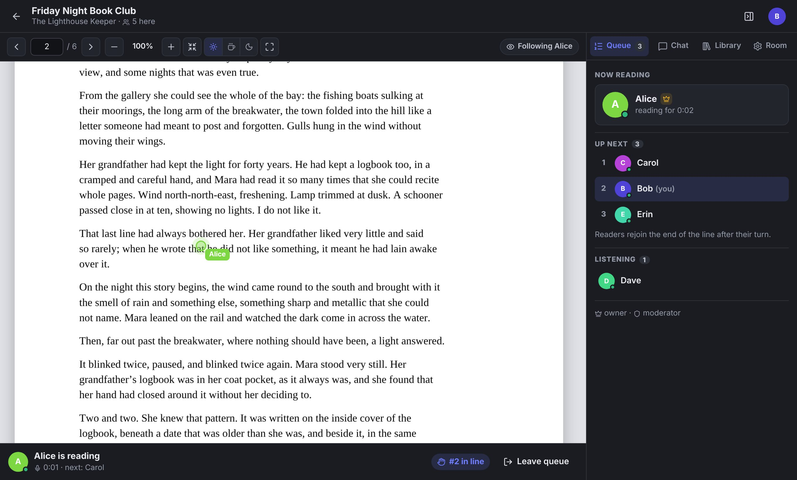
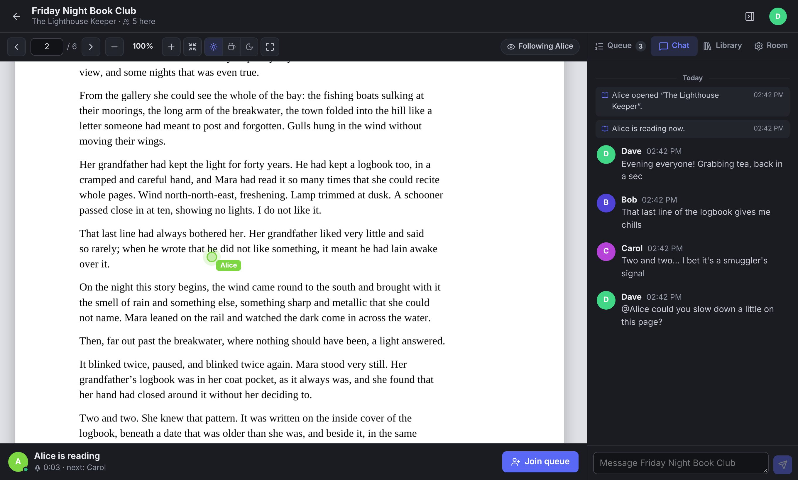

# Reading Room

Read books together with your Discord server. Instead of one person screen-sharing a PDF, everyone opens the same book in their own browser and follows the current reader page by page, while you keep talking on Discord voice.



- **Many formats** – PDF, EPUB, plain text, Markdown and comic archives (CBZ).
- **Synced pages** – whoever is reading turns the pages (and scrolls) for everyone. Their mouse pointer shows up on PDF and comic pages, and text they select in an EPUB is highlighted for everyone, much like a screen share. Anyone can browse ahead and jump back to the reader with one click.
- **Discord sign-in** – one queue spot per Discord account, so opening more browsers or tabs doesn't get anyone extra turns. Anyone with a Discord account can join, or you can limit sign-in to members of one or more Discord servers.
- **Highlights** – moderators and admins can switch on the highlighter and mark text (or, on scanned PDF and comic pages, an area) in four colours. Everyone sees the highlights live, and they stay with the book. The highlights list jumps straight to each one, and moderators can click a highlight to remove it.
- **Dictionary** – select a word to see its meaning, with a link to the Oxford Learner's Dictionary. Definitions come from a built-in copy of Princeton WordNet (about 155,000 words, works offline and understands forms like "ran" or "mice"). Wiktionary fills in rare words, and Oxford Dictionaries is used first if you add API keys.
- **Site admins by Discord ID** – the IDs in `ADMIN_USER_IDS` are admins in every room. They can add more admins by Discord user ID from the site.
- **Reading queue** – join the line, **Finish** your turn or **Pass** it on. Readers can go back to the end of the line automatically, and a reader who disconnects is skipped after a grace period.
- **Moderation** – the person who creates the room (and uploads the book) is its owner. Owners and moderators can reorder the queue (drag and drop), hand the turn to someone, skip or pause the reader, lock or shuffle the queue, add moderators, kick or ban people, and manage the room's library.
- **Chat** – room chat with history. Turn changes are logged in the chat, and you get a sound and an optional desktop notification when it's your turn.
- **Saved progress** – each book remembers where the group stopped, so next week's session picks up from there.
- **Clean book names** – titles and authors are read from the book's own metadata, or tidied up from download file names (`Title -- Author -- … -- Anna's Archive.pdf` becomes *Title* by *Author*). Moderators can edit both in the library.
- **Turn timer** – moderators can set a suggested turn length. Everyone sees the timer, and the reader gets a gentle nudge when time is up; nobody is cut off.
- **Discord channel notifications** – connect a channel webhook and the room posts "reading has started", "it's your turn" (with an @mention ping for the next reader), book changes and the next session time to Discord.
- **Reading stats and fair turns** – see who has read how long (this book or all books), who passed, and who hasn't read yet. Moderators can put whoever has read least at the front of the queue.
- **Live reactions** – listeners can send 👏 ❤️ 😂 😮 😢 🔥, which float up over the page for everyone.
- **Next session** – moderators set the date and time; everyone sees it in their own time zone and can add it to their calendar.
- **Progress** – page counts and how far the group is (page 120 of 300, 40%) on room cards and in the library.
- **Fast with big PDFs** – PDFs stream in pieces, so the first page shows before the whole file has downloaded.



## How a session works

1. Someone creates a room, uploads a book and shares the room link in Discord.
2. People sign in with Discord and open the room. Everyone sees the same page.
3. Click **Join queue**. If nobody is reading, the first person in line starts right away.
4. The reader reads aloud on Discord voice and turns the pages. Everyone else follows automatically.
5. When they're done, the reader clicks **Finish turn**, or **Pass** if they'd rather not read. The next person in line gets the turn and a notification.

| Role | Can do |
| --- | --- |
| Member | Join or leave the queue, finish or pass their own turn, browse freely, chat, delete their own messages |
| Current reader | Turn pages and scroll for everyone, show their pointer or highlight |
| Moderator | Everything above, plus: reorder, shuffle, lock or clear the queue; make someone the reader; skip or pause the reader; kick or ban people; highlight; open, upload or delete books; change room settings; delete any message |
| Owner (room creator) | Everything above, plus: add or remove moderators, delete the room |
| Site admin | Owner rights in every room. Root admins (`ADMIN_USER_IDS`) can also add and remove other site admins by Discord user ID (account menu → **Site admins**) |

## Quick start (local)

Requirements: Node.js 22 or newer.

```bash
npm install
```

```bash
npm run dev
```

Open http://localhost:5173. Discord isn't configured yet, so the login page offers a **developer login** where you pick any name. Open a second browser (or a private window) with a different name to try the queue.

To use Discord sign-in locally, copy `.env.example` to `.env`, fill in the Discord values (see [Discord setup](docs/DEPLOYMENT.md#1-create-the-discord-application)) and add `http://localhost:5173/auth/discord/callback` as a redirect in the Discord developer portal.

## Going live for free

See **[docs/DEPLOYMENT.md](docs/DEPLOYMENT.md)**. In short:

- **Easiest:** [Render](https://render.com) free web service plus a free [Turso](https://turso.tech) database. No credit card needed; the site sleeps when nobody uses it.
- **Always on:** an Oracle Cloud "Always Free" VM with Docker Compose and automatic HTTPS (Caddy).

## Configuration

All settings are environment variables. `.env.example` has the full list with comments.

| Variable | Purpose |
| --- | --- |
| `PUBLIC_URL` | Public address of the site (defaults to Render's URL on Render) |
| `SESSION_SECRET` | Random string that signs login cookies |
| `DISCORD_CLIENT_ID`, `DISCORD_CLIENT_SECRET` | Discord OAuth application |
| `ADMIN_USER_IDS` | Discord user IDs of root site admins (owner rights everywhere, can add more admins) |
| `DISCORD_GUILD_IDS` | Optional: only members of these Discord servers can sign in (empty = anyone) |
| `DISCORD_ADMIN_ROLE_IDS` | Optional: roles in those servers that make someone a site admin |
| `DICTIONARY_PROVIDER`, `OXFORD_APP_ID`, `OXFORD_APP_KEY` | Word look-ups: built-in WordNet + Wiktionary, Oxford first with keys (`offline` or `off` also possible) |
| `DATABASE_URL`, `DATABASE_AUTH_TOKEN` | SQLite file (default) or a remote libSQL/Turso database |
| `STORAGE_DRIVER` | Where book files are kept: `local` disk or the `database` (`auto` picks the database when it is remote) |
| `MAX_UPLOAD_MB`, `MAX_ROOMS_PER_USER`, `MAX_BOOKS_PER_ROOM` | Limits |
| `DEV_LOGIN` | Username-only login for testing; never enable it on a public site |

## Development

```bash
npm run dev        # server (port 3000) + Vite client (port 5173) with hot reload
npm test           # unit and integration tests (Vitest)
npm run typecheck  # TypeScript, server and client
npm run build      # production build into dist/
npm start          # run the production build
```

Project layout:

```
server/   Express + Socket.IO backend
  auth.ts       Discord OAuth, signed session cookies, developer login
  rooms.ts      live room state: presence, queue, moderation, chat
  turns.ts      pure queue/turn logic (unit tested)
  api.ts        REST endpoints: rooms, uploads, book files, dictionary, site admins
  dictionary.ts word look-ups: Oxford (optional) → built-in WordNet → Wiktionary, cached
  wordnet.ts    offline WordNet 3.1 reader with lemmatisation
  storage.ts    book files on disk or chunked into the database
  db.ts         libSQL / SQLite schema and queries
client/   React app (Vite)
  reader/       PDF (pdf.js), EPUB (epub.js), text/Markdown and CBZ readers
  room/         queue, chat, library and settings panels
shared/   types shared by both sides (socket protocol, positions)
tests/    Vitest tests, including a fake Discord API for the OAuth flow
```

### How syncing works

The server stores one position per book: a page number plus the scroll point for page-based formats, or an EPUB CFI. Only the current reader, or a moderator when nobody is reading, can change it. Everyone else's reader follows that position until they turn a page themselves; then they browse on their own until they click **Back to …**. Scroll positions are shared as "the point of the page in the middle of the screen", so people with different screen sizes see the same lines.

### Security notes

- Uploads are checked by extension and by file signature, and are limited in size. EPUB content renders in a sandboxed iframe with scripts disabled, Markdown is sanitised, and the site sends a strict Content-Security-Policy.
- Discord access tokens are only used during sign-in and are revoked right after. Sessions are HMAC-signed, HTTP-only cookies.
- State-changing requests need a custom header, which stops cross-site form posts.
- Book files are only served to signed-in users who aren't banned from the room.

## Ideas for later

- Run it as a Discord Activity inside a voice channel (Discord Embedded App SDK).
- Per-chapter reading schedules and attendance stats.
- Notes attached to highlights.

## License

MIT. The bundled dictionary data is [WordNet 3.1](https://wordnet.princeton.edu/) © Princeton University, used under the WordNet licence.
